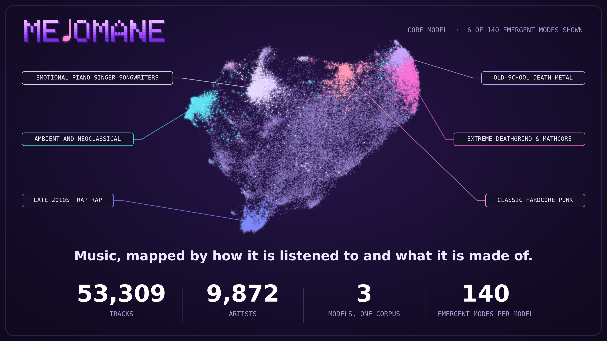

<p align="center">
  
</p>

# Melomane

**A map of music, by how it is listened to and what it is made of.**

[](https://github.com/ravjothbrar/melomane/actions/workflows/ci.yml)
[](LICENSE)
[](DATA_LICENSE.md)

### → [Explore the map: ravjothbrar.com/melomane](https://ravjothbrar.com/melomane/)

*A large-screen tool: tablet, laptop or desktop (an unfolded foldable works too).*

---

## What is this?

Melomane is an interactive map of tens of thousands of tracks. Three models learn from the same tracks in the same way and differ only in what they are allowed to read. Pick any track to see its neighbours in each model, then steer the query toward a genre or an emergent direction.

## Why?

Music recommenders are black boxes: they tell you what to play next, never why. Melomane makes that geometry inspectable, so you can see whether two tracks sit together because people play them together or because of what they are made of.

The two reasons are very different. Listening data carries popularity, scenes and culture, along with their biases; audio and lyrics carry how the music actually sounds. Most systems blend the two invisibly. Melomane trains three models on the same tracks, with the same objective, changing *only* what each one may read, so any difference between their maps can be attributed to its source. And because the spaces have directions you can name (a genre, or a "mode" that emerges from the data), you can steer from a song toward an idea and watch what changes, instead of accepting a ranking you cannot question.

Everything is open: the code (MIT), the derived data (CC BY 4.0) and the decision log, so the comparison can be checked and argued with.

## The three models

| **Melomane-Cooc**<br>*Streaming habits* | **Melomane-Composition**<br>*Pure sound* | **Melomane-Core**<br>*The hybrid* |
|---|---|---|
| Learned only from listening sessions: two tracks are close when the same people play them in the same sitting. | Learned only from measured audio and lyric features (timbre, rhythm, harmony, loudness, lyric themes), with no listening data at all. | Listening sessions and measured features together, with listening weighted ten to one. |

The embeddings themselves are LLM-free. A language model is used only to curate and tag tracks and to name the emergent modes, and it never sees lyrics or audio.

## Using the map

- **Click a point or search** for an artist or track: its nearest neighbours appear, with the links between them drawn on the map.
- **Switch model** (Cooc, Composition, Core, plus acoustic-only and lyric-only Composition) and watch the same track move into a different neighbourhood.
- **Steer**: choose a direction (a genre, or an emergent mode) and rotate the query toward it with the angle slider (spherical interpolation). At 0° you get the track's own neighbours; as the angle grows, results move toward the direction while staying close to the seed.
- **Take the guided tour** from the pop-up for a worked example. Its text is computed from the data, never typed in.

The 2-D layout (UMAP) is for display only; neighbours and steering are computed in the full embedding space, in your browser, from a small int8 payload.

## What was measured

The map is backed by a pre-registered comparison of the three models ([`analysis_plan.lock.json`](analysis_plan.lock.json)), reported whatever the outcome, nulls and failures included. The one methodological trap that matters most for music is **artist leakage**: tracks by one artist share voice and audience, so every probe is cross-validated with folds grouped by artist and nearest-neighbour purity excludes the query's own artist. The numbers below are generated from `results/` by the pipeline; nothing here is typed by hand.

<details>
<summary>Generated results</summary>

<!-- BEGIN GENERATED RESULTS -->
_Generated by stage S13 from `results/` on 2026-10-10 · corpus `onion` · profile `standard` · 53,309 tracks, 9,872 artists. Do not edit by hand._

| Model | Participation ratio (of 300) | Mean pairwise cosine |
|---|---|---|
| Melomane-Cooc | 45.0 ± 0.2 | 0.153 ± 0.000 |
| Melomane-Composition | 200.2 ± 1.2 | 0.074 ± 0.003 |
| Melomane-Core | 176.3 ± 1.9 | 0.091 ± 0.007 |

*Embedding geometry; mean ± sd over seeds.*

| Model | Baked-in (a) ρ | Held-out (b) ρ | External (c) ρ | Cultural d |
|---|---|---|---|---|
| Melomane-Cooc | 0.385 ± 0.000 | 0.240 ± 0.001 | 0.550 ± 0.001 | 1.838 ± 0.005 |
| Melomane-Composition | 0.643 ± 0.002 | 0.333 ± 0.001 | 0.505 ± 0.003 | 0.641 ± 0.004 |
| Melomane-Core | 0.645 ± 0.003 | 0.326 ± 0.002 | 0.550 ± 0.007 | 1.649 ± 0.029 |

*Mean over probes in each stratum of the artist-grouped, fold-trained direction score (Spearman ρ; Cohen's d for the cultural stratum). n/a means the stratum had no evaluable probe in this run, not a score of zero.*

Probes per stratum: a_baked: 17, b_heldout: 50, c_external: 15, cultural: 8. Evaluation tracks (test artists only): 41,914.

| Contrast | Stratum | Δρ | 95% CI | p | Probes | Share of probes > 0 |
|---|---|---|---|---|---|---|
| Composition − Cooc | (a) | 0.259 | [0.250, 0.268] | 0.001 | 17 | 100% |
| Composition − Cooc | (b) | 0.094 | [0.088, 0.099] | 0.001 | 41 | 98% |
| Composition − Cooc | (c) | -0.043 | [-0.055, -0.031] | 0.001 | 15 | 40% |
| Core − Cooc | (a) | 0.259 | [0.251, 0.269] | 0.001 | 17 | 100% |
| Core − Cooc | (b) | 0.089 | [0.084, 0.093] | 0.001 | 41 | 98% |
| Core − Cooc | (c) | -0.005 | [-0.015, 0.006] | 0.448 | 15 | 60% |
| Composition − Core | (a) | -0.001 | [-0.002, 0.001] | 0.392 | 17 | 59% |
| Composition − Core | (b) | 0.005 | [0.003, 0.008] | 0.001 | 41 | 56% |
| Composition − Core | (c) | -0.039 | [-0.044, -0.034] | 0.001 | 15 | 20% |

*Paired differences, artist-clustered bootstrap (seed 0 models).*

|  | Claim | Outcome |
|---|---|---|
| H1 | Composition >= Cooc on held-out (b) and external (c) strata | NOT SUPPORTED |
| H2 | Core has the lowest participation ratio and highest mean pairwise cosine | NOT SUPPORTED |
| H3 | Composition >= Cooc on regional Cohen's d | NOT SUPPORTED |
| H4 | curated vocabulary > size-matched raw on artist-disjoint kNN purity lift (lift difference > 0) | MIXED / INCONCLUSIVE |
| H5 | LLM dimensions correlate with measured counterparts (Spearman > 0, 95% CI excluding 0) for >= 70% of dimensions | SUPPORTED |
| H6 | Composition keeps >= 90% of full-precision held-out rho at <= 64 dims (fp16/int8) | SUPPORTED |
| H7 | precision@10 of the pole tag increases with theta up to 60 deg for >= 80% of poles | SUPPORTED |
| H8 | conclusions on the standard training budget match those on the paper budget (subset) | SUPPORTED |

*Pre-registered hypotheses (analysis_plan.lock.json) and their outcomes, nulls included.*

- H1 (Composition minus Cooc): baked-in Δρ 0.259 [0.250, 0.268], 100% of 17 probes positive; held-out Δρ 0.094 [0.088, 0.099], 98% of 41 probes positive; LLM-label Δρ -0.043 [-0.055, -0.031], 40% of 15 probes positive.
- H2: participation ratio Melomane-Cooc 45.0, Melomane-Composition 200.2, Melomane-Core 176.3.
- H3 (regional one-vs-rest Cohen's d, 8 regions): Melomane-Cooc 1.84, Melomane-Composition 0.64, Melomane-Core 1.65.
- H4 verdicts by label set: category inconclusive, region inconclusive.
- H5: 83% of 6 LLM dimensions with a measured counterpart correlate positively with a CI excluding 0; wrong-sign dimensions: aggression.
- H6: best retention of full-precision held-out ρ at 64 dimensions or fewer is 94%.
- H8 (8,000-track subset): Composition minus Cooc ρ is 0.092 at the standard budget and 0.070 at the paper budget; same ρ ordering (yes), same lowest-PR model (yes).
<!-- END GENERATED RESULTS -->

</details>

Full tables and per-hypothesis detail are in [`results/`](results) and [`reports/`](reports). The code ships with a first-pass write-up in [`paper/`](paper), which is a draft and not yet reviewed.

## Run it yourself

Windows 11 or Linux, Python 3.10 or newer; an NVIDIA GPU is strongly recommended for training (CUDA 12.8 or newer for RTX 50-series cards).

```bash
uv sync                                            # or: python -m venv .venv && pip install -e ".[dev]"
cp .env.example .env                               # optional: OPENROUTER_API_KEY, only for the LLM stages
python -m melomane doctor                          # GPU, disk and LLM smoke test
python -m melomane demo                            # the whole pipeline on a synthetic corpus (minutes)
python -m melomane run-all --corpus onion --profile standard   # the real run (hours; resumable, idempotent)
python -m pytest -q -m "not gpu"                   # tests
python -m melomane serve --dir release/onion/standard/explorer # the explorer, locally
```

The real run downloads Music4All-Onion (about 20 GB) from Zenodo. Artist and title strings are not part of that record; see [`DATA_LICENSE.md`](DATA_LICENSE.md) and [`DECISIONS.md`](DECISIONS.md) for where they come from and how they are handled.

## A similar approach

The method follows the approach of the Epicure papers on food-ingredient embeddings ([arXiv:2604.22776](https://arxiv.org/abs/2604.22776), [arXiv:2605.22391](https://arxiv.org/abs/2605.22391)): hold the learning objective fixed, vary only what the model reads, then look for interpretable directions and steer along them. Melomane applies that idea to music, and adds controls for problems music has that food does not, chiefly artist leakage.

## Data, licences, attribution

- Code: MIT ([`LICENSE`](LICENSE)). Derived artefacts: CC BY 4.0, subject to [`DATA_LICENSE.md`](DATA_LICENSE.md).
- Built on **Music4All-Onion** (Moscati, Parada-Cabaleiro, Deldjoo, Zangerle, Schedl; CIKM 2022; Zenodo 15394646; CC BY 4.0), whose listening events come from Last.fm.
- Artist, title and album strings are Music4All metadata (Santana et al., IWSSIP 2020) as redistributed on Hugging Face ([`seungheondoh/enrich-music4all`](https://huggingface.co/datasets/seungheondoh/enrich-music4all)), shown with attribution.
- No audio, no lyrics and no per-user data are included.

## Repository map

```
src/melomane/      the library: sessions, cooc, compounds, walks, torch_sgns, geometry, slerp, probes, ica_modes, llm, api
  adapters/        data adapters (Music4All-Onion, MusicBrainz stack, Jamendo, FMA, playlists)
  stages/          the pipeline, S0 to S14: idempotent and resumable
  analysis/        paired statistics, WEAT, Procrustes, compression, attribution, direction test, sensitivity grid
apps/explorer/     the static WebGL2 map (no dependencies);  apps/mcp_server/  a read-only MCP server
configs/           profiles (smoke, standard, paper), LLM and data settings
results/ reports/  generated outputs: the single source of every reported number
PLAN.md            the specification;  DECISIONS.md  every decision and deviation;  CLAUDE.md  how the pipeline is operated
```

## Citing

See [`CITATION.cff`](CITATION.cff).
