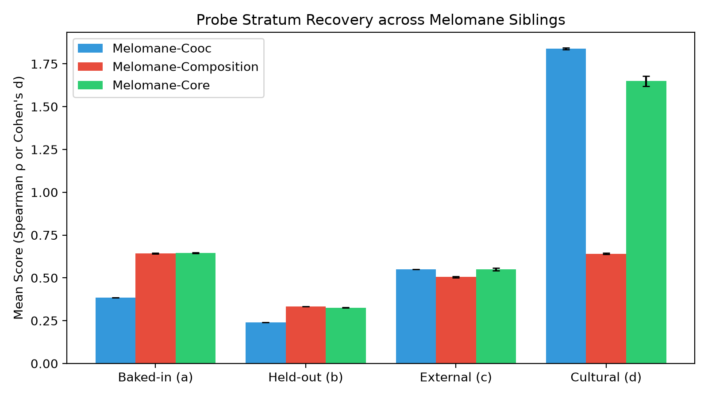
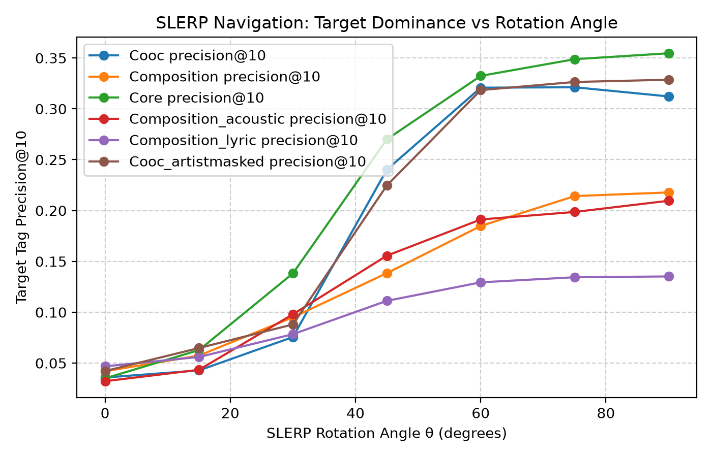

# Melomane: emergent geometry in music-track embeddings, and what measured composition adds to listening behaviour

_Ravjoth Brar · preprint pending · generated 2026-10-10 from `results/` · corpus `onion` · profile `standard`_

## Abstract

Melomane transfers the Epicure methodology (Radzikowski & Chen, arXiv:2604.22776, arXiv:2605.22391) from food ingredients to music tracks: three skip-gram models share one vocabulary and one training objective and differ only in the random-walk schema (listening sessions, measured audio and lyric feature clusters, or a blend). We train them on 53,309 tracks by 9,872 artists (corpus `onion`) and test eight pre-registered hypotheses with artist-grouped cross-validation. Outcome: 4 supported, 3 not supported, 0 not evaluable, 1 mixed/inconclusive. On held-out artists, the Composition model beat Cooc on baked-in and held-out probes but fell behind it on LLM-label probes (baked-in Δρ = 0.259 [0.250, 0.268]; held-out Δρ = 0.094 [0.088, 0.099]; LLM-label Δρ = -0.043 [-0.055, -0.031]; artist-clustered bootstrap), so H1 is not supported. Regional (cultural) structure is carried mostly by listening behaviour: Cohen's d is 1.84 for Cooc, 1.65 for Core and 0.64 for Composition (H3 not supported). Steering by spherical interpolation raises target-tag precision with rotation angle for 94%, 80% and 94% of poles in Cooc, Composition and Core (H7 supported). The conclusions hold when the scaled-down training budget is replaced by the full paper budget on an 8,000-track subset (H8). The embeddings themselves are LLM-free; a language model is used only for curation, tagging and naming. This is a preprint-pending write-up generated from the result files.

## 1. Introduction

A track can be placed in a space by what people play around it (collaborative context) or by what it is made of (timbre, rhythm, harmony, loudness, lyric themes). Epicure showed for food that holding the skip-gram objective fixed and changing only the walk schema between co-occurrence and a typed compound layer yields different but complementary geometries. Melomane runs the same controlled comparison for music and asks whether the findings transfer; it does not claim to reproduce Epicure's numbers.

Music adds a trap that food does not have: tracks by one artist share voice, production and audience, so any probe that can see two tracks of the same artist on both sides of a train/test split measures artist identity. Every probe here is grouped by artist, and nearest-neighbour purity excludes the query's artist.

## 2. Data and curation

| Quantity | Value |
|---|---|
| Tracks in the vocabulary | 53,309 |
| Distinct artists (normalised name) | 9,872 |
| Tracks with audio/lyric features | 109,269 |
| Tracks with any listening data | 56,512 |
| Listening sessions | 12,683,611 |
| Mean / median session length | 8.1 / 7 |
| Behaviour-graph edges (mean degree) | 3,954,989 (148.4) |
| Compound nodes | 3,300 |
| Consolidation ratio (curation) | 1.01 |

*Corpus and graph sizes, read from the stage result files.*

Sessions are listening events split at 30-minute gaps (5–200 distinct tracks). Behaviour edges are positive-NPMI pairs (minimum 5 co-occurrences, top 250 per track). Compound nodes are k-means clusters per feature family over whitened PCA blocks of the measured audio and lyric descriptors; each track links to its three nearest clusters per family. Voice, emotion (GEMS), lyric sentiment/VAD and all learned embeddings are held out of the compound vocabulary and used only as probe targets or comparisons.

Only 56,512 of the 109,269 tracks that have audio features have any listening data, so the behaviour model (and therefore the three-way comparison) is limited to those.

## 3. Models and training

| Model | Seeds | Epochs | Tokens / epoch | Seconds (last seed) | Seed-to-seed neighbour recall@10 |
|---|---|---|---|---|---|
| Melomane-Cooc | 3 | 6 | 10,661,800 | 227 | 0.57 |
| Melomane-Composition | 3 | 6 | 85,294,400 | 1161 | 0.42 |
| Melomane-Core | 3 | 6 | 191,912,400 | 2655 | 0.46 |

*Training summary (S5). Seed-to-seed recall is the fraction of top-10 neighbours shared by two seeds of the same model.*

Cooc walks only the behaviour graph; Composition walks only the typed compound templates (no track–track template); Core adds ten track–track templates per round to all compound templates. All three share the vocabulary, dimension (300), window, negative sampling and learning rate. The walk budget is scaled below the Epicure paper's (see Limitations); the equal-token control and the paper-budget subset check test whether that matters.

## 4. Results

### 4.1 Geometry

| Model | Participation ratio (of 300) | Mean pairwise cosine |
|---|---|---|
| Melomane-Cooc | 45.0 ± 0.2 | 0.153 ± 0.000 |
| Melomane-Composition | 200.2 ± 1.2 | 0.074 ± 0.003 |
| Melomane-Core | 176.3 ± 1.9 | 0.091 ± 0.007 |

*Embedding geometry; mean ± sd over seeds.*

### 4.2 Direction quality by probe stratum

| Model | Baked-in (a) ρ | Held-out (b) ρ | External (c) ρ | Cultural d |
|---|---|---|---|---|
| Melomane-Cooc | 0.385 ± 0.000 | 0.240 ± 0.001 | 0.550 ± 0.001 | 1.838 ± 0.005 |
| Melomane-Composition | 0.643 ± 0.002 | 0.333 ± 0.001 | 0.505 ± 0.003 | 0.641 ± 0.004 |
| Melomane-Core | 0.645 ± 0.003 | 0.326 ± 0.002 | 0.550 ± 0.007 | 1.649 ± 0.029 |

*Mean over probes in each stratum of the artist-grouped, fold-trained direction score (Spearman ρ; Cohen's d for the cultural stratum). n/a means the stratum had no evaluable probe in this run, not a score of zero.*

Probes per stratum: a_baked: 17, b_heldout: 50, c_external: 15, cultural: 8. Evaluation tracks (test artists only): 41,914.

| Contrast | Stratum | Δρ | 95% CI | p | Probes | Share of probes > 0 |
|---|---|---|---|---|---|---|
| Composition − Cooc | (a) | 0.259 | [0.250, 0.268] | 0.001 | 17 | 100% |
| Composition − Cooc | (b) | 0.094 | [0.088, 0.099] | 0.001 | 41 | 98% |
| Composition − Cooc | (c) | -0.043 | [-0.055, -0.031] | 0.001 | 15 | 40% |
| Core − Cooc | (a) | 0.259 | [0.251, 0.269] | 0.001 | 17 | 100% |
| Core − Cooc | (b) | 0.089 | [0.084, 0.093] | 0.001 | 41 | 98% |
| Core − Cooc | (c) | -0.005 | [-0.015, 0.006] | 0.448 | 15 | 60% |
| Composition − Core | (a) | -0.001 | [-0.002, 0.001] | 0.392 | 17 | 59% |
| Composition − Core | (b) | 0.005 | [0.003, 0.008] | 0.001 | 41 | 56% |
| Composition − Core | (c) | -0.039 | [-0.044, -0.034] | 0.001 | 15 | 20% |

*Paired differences, artist-clustered bootstrap (seed 0 models).*

### 4.3 Hypotheses

|  | Claim | Outcome |
|---|---|---|
| H1 | Composition >= Cooc on held-out (b) and external (c) strata | NOT SUPPORTED |
| H2 | Core has the lowest participation ratio and highest mean pairwise cosine | NOT SUPPORTED |
| H3 | Composition >= Cooc on regional Cohen's d | NOT SUPPORTED |
| H4 | curated vocabulary > size-matched raw on artist-disjoint kNN purity lift (lift difference > 0) | MIXED / INCONCLUSIVE |
| H5 | LLM dimensions correlate with measured counterparts (Spearman > 0, 95% CI excluding 0) for >= 70% of dimensions | SUPPORTED |
| H6 | Composition keeps >= 90% of full-precision held-out rho at <= 64 dims (fp16/int8) | SUPPORTED |
| H7 | precision@10 of the pole tag increases with theta up to 60 deg for >= 80% of poles | SUPPORTED |
| H8 | conclusions on the standard training budget match those on the paper budget (subset) | SUPPORTED |

*Pre-registered hypotheses (analysis_plan.lock.json) and their outcomes, nulls included.*

- H1 (Composition minus Cooc): baked-in Δρ 0.259 [0.250, 0.268], 100% of 17 probes positive; held-out Δρ 0.094 [0.088, 0.099], 98% of 41 probes positive; LLM-label Δρ -0.043 [-0.055, -0.031], 40% of 15 probes positive.
- H2: participation ratio Melomane-Cooc 45.0, Melomane-Composition 200.2, Melomane-Core 176.3.
- H3 (regional one-vs-rest Cohen's d, 8 regions): Melomane-Cooc 1.84, Melomane-Composition 0.64, Melomane-Core 1.65.
- H4 verdicts by label set: category inconclusive, region inconclusive.
- H5: 83% of 6 LLM dimensions with a measured counterpart correlate positively with a CI excluding 0; wrong-sign dimensions: aggression.
- H6: best retention of full-precision held-out ρ at 64 dimensions or fewer is 94%.
- H8 (8,000-track subset): Composition minus Cooc ρ is 0.092 at the standard budget and 0.070 at the paper budget; same ρ ordering (yes), same lowest-PR model (yes).

### 4.4 Emergent modes

| Model | Stable ICA factors | Modes | Coherence vs random | Mode drivers | Label audit agreement |
|---|---|---|---|---|---|
| Melomane-Cooc | 20 | 140 | 0.38 vs 0.15 (×2.5) | behaviour 119, acoustic 11, lyric 10 | 79% |
| Melomane-Composition | 20 | 140 | 0.14 vs 0.07 (×2.0) | acoustic 134, behaviour 3, lyric 3 | 93% |
| Melomane-Core | 20 | 140 | 0.18 vs 0.10 (×1.8) | acoustic 117, behaviour 16, lyric 7 | 100% |

*FastICA on category-residualised embeddings → GMM modes (S6). Drivers: whether a mode's members share behaviour, acoustic or lyric compounds.*

### 4.5 Steering by SLERP

| Model | Seed×pole pairs | Poles | Poles with precision increasing to 60° (95% CI) | Mean Spearman ρ(θ, precision) | Median orthogonal-residual SNR |
|---|---|---|---|---|---|
| Melomane-Cooc | 500 | 49 | 94% [0.86, 1.00] | 0.84 | 1.38 |
| Melomane-Composition | 500 | 49 | 80% [0.67, 0.90] | 0.64 | 0.56 |
| Melomane-Core | 500 | 49 | 94% [0.86, 1.00] | 0.84 | 0.57 |

*Quantitative direction test: precision@10 of the pole's tag among artist-disjoint retrievals as the rotation angle grows (S8).*

$$ d_\perp = d - (d\cdot v)\,v,\qquad q(\theta) = \cos\theta\, v + \sin\theta\, \frac{d_\perp}{\lVert d_\perp\rVert} $$

### 4.6 LLM labels versus measured features

| LLM dimension | Measured counterpart | n | Spearman ρ | 95% CI |
|---|---|---|---|---|
| energy | loudness | 8,504 | 0.373 | [0.355, 0.391] |
| aggression | dynamic_complexity | 8,504 | -0.437 | [-0.456, -0.418] |
| danceability | danceability | 8,504 | 0.285 | [0.264, 0.306] |
| tempo_feel | bpm | 8,504 | 0.077 | [0.054, 0.098] |
| punch | onset_rate | 8,504 | 0.181 | [0.159, 0.203] |
| brightness | spectral_centroid | 8,504 | 0.318 | [0.300, 0.336] |

*Agreement between LLM-labelled dimensions (artist + title + tags only) and instrument-measured features, before touching embeddings.*

### 4.7 Extensions

| Extension | Status | Detail |
|---|---|---|
| E1 compression frontier | done | Composition: 100-d int8 = 4.5 MB, retention 97%; Core: 64-d int8 = 2.9 MB, retention 96%; Cooc: 16-d int8 = 0.9 MB, retention 98% |
| E2 acoustic vs lyric attribution | done | gain over Cooc split: acoustic 12%, lyric 88% |
| E3 partial-hub regime | done | 10% of tracks with compound links: mean ρ 0.250 vs Cooc 0.254 (linked tracks 0.199 vs 0.251; unlinked 0.255 vs 0.254); 30% of tracks with compound links: mean ρ 0.257 vs Cooc 0.254 (linked tracks 0.248 vs 0.252; unlinked 0.260 vs 0.254); 60% of tracks with compound links: mean ρ 0.291 vs Cooc 0.254 (linked tracks 0.296 vs 0.255; unlinked 0.284 vs 0.252); 100% of tracks with compound links: mean ρ 0.337 vs Cooc 0.254 (linked tracks 0.337 vs 0.254; unlinked n/a vs n/a) |
| E4 equal-token control | done | H1 under equal token budgets: not supported; held-out ρ Cooc 0.240 vs Composition 0.333 |
| E5 external-embedding agreement | done | mean linear CKA with external audio/lyric embeddings: Cooc 0.12, Composition 0.17, Core 0.18; top-10 neighbour overlap (Jaccard) at most 0.026, near chance |
| E6 temporal stability | done | Cooc trained on the early vs late half of 15.1 years of sessions: Procrustes disparity 0.66 (shuffled-null 1.00), row cosine 0.58; modes: mean best-match Jaccard 0.21 vs null 0.03, 2.1% persist |
| E7 curation policy | done | H4 mixed / inconclusive: category lift difference 0.14 [-0.03, 0.30] (inconclusive); region lift difference -0.00 [-0.06, 0.05] (inconclusive) |
| E8 sensitivity grid | done | Composition − Cooc held-out Δρ ≥ 0 in 27 of 27 settings of the sensitivity grid (range 0.019 to 0.103, median 0.086) |

*Extensions beyond the original papers (S9); full tables are in results/.*

*Probe-stratum means by model.*

*Target-tag precision@10 against rotation angle.*

## 5. Limitations

- Onion's listening data come from a Last.fm-era, Western-skewed population; findings are about this catalogue, not music in general.
- Only tracks with listening data can be in the three-way comparison (56,512 of 109,269).
- Artist, title and album strings are Music4All metadata as redistributed on Hugging Face (`seungheondoh/enrich-music4all`), a dataset that declares no licence; they are published with attribution (see DATA_LICENSE.md). 2 tracks have no artist name and are treated as separate artists.
- Artist structure: same-artist tracks are strongly correlated; all probes are artist-grouped, but unmodelled structure (label, era, collaborators) can still leak.
- Features are track-level aggregates of 30-second clips, not frame-level audio; instrumental tracks have no lyric edges.
- The walk budget is scaled below the Epicure paper's (profile `standard`); the equal-token control and the paper-budget subset check bound, but do not remove, this caveat.
- Probes target properties of the compound inputs themselves (stratum a), properties held out of them (b) and LLM labels (c); only (b) and (c) test generalisation beyond what the Composition model was given.
- Curation is rules-only for this run (1300/1333 refinement requests failed; those items kept unmerged), so duplicate versions are merged only by normalised (artist, title) keys; a full LLM curation pass is left as an ablation.
- LLM labels (stratum c, supervised poles) cover a seeded random sample of 8,504 tracks (16% of the vocabulary), limited by the LLM budget; the rest keep a rule-based genre; excluded as unreliable (second-prompt Spearman below 0.6): space.
- The largest compound cluster holds 5.12% of tracks, narrowly above the 5% limit set in the plan (recorded, not tuned).
- The number of modes is set by the model-selection range, not discovered: the GMM selected 7.0 components per factor on average against a ceiling of 7, i.e. it hit the ceiling for (nearly) every factor.
- The pre-registered measured counterpart for aggression correlates in the opposite direction to the LLM label, so that pairing was probably specified with the wrong sign.

## 6. Ethics, licences and data handling

The embeddings are learned without any language model. Lyrics and audio are never redistributed and never sent to a language model; no per-user data is released. Upstream data: Music4All-Onion (CC BY 4.0; Moscati et al., CIKM 2022), listening events from Last.fm. Artist and title strings are shown with attribution to Music4All and `seungheondoh/enrich-music4all` (no licence declared; see limitations). Code is MIT; derived artefacts are CC BY 4.0 subject to DATA_LICENSE.md.

## 7. Reproducibility

Every figure and table is generated from the files under `results/` by `python -m melomane run-all`; see `paper/reproducibility.md` for the environment, seeds and LLM spend, and `analysis_plan.lock.json` (including its amendments) for the pre-registration trail.
